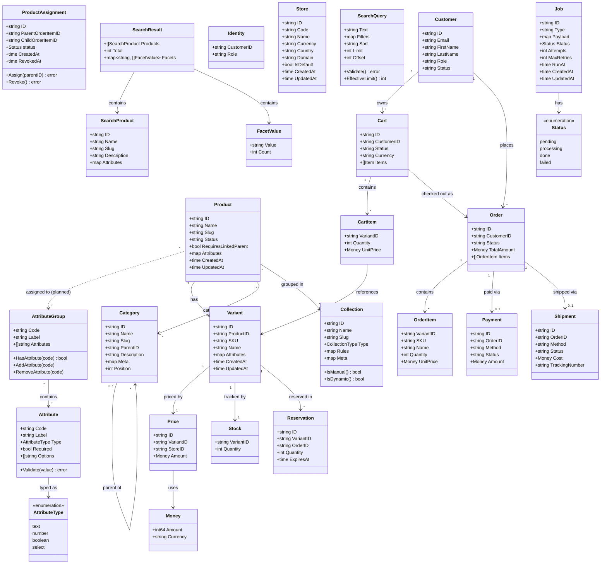

# C4 Level 4 — Code Diagram

Shows the domain model entities, their relationships, and the hexagonal port/adapter boundaries.

## Domain Entities & Relationships



## Hexagonal Architecture — Ports & Adapters

```mermaid
classDiagram
    direction LR

    class ProductRepository {
        <<interface>>
        +FindByID(ctx, id) Product
        +FindBySlug(ctx, slug) Product
        +List(ctx, offset, limit) []Product
        +FindByCategoryID(ctx, catID, offset, limit) []Product
        +Create(ctx, product) error
        +Update(ctx, product) error
        +WithTx(tx) ProductRepository
    }

    class CartRepository {
        <<interface>>
        +FindByID(ctx, id) Cart
        +FindActiveByCustomerID(ctx, custID) Cart
        +Save(ctx, cart) error
        +Delete(ctx, id) error
    }

    class OrderRepository {
        <<interface>>
        +FindByID(ctx, id) Order
        +FindByIDs(ctx, ids) map
        +FindByCustomerID(ctx, customerID) []Order
        +List(ctx, offset, limit) []Order
        +Save(ctx, order) error
        +UpdateStatus(ctx, order) error
    }

    class CategoryRepository {
        <<interface>>
        +FindByID(ctx, id) Category
        +FindBySlug(ctx, slug) Category
        +FindAll(ctx) []Category
        +Create(ctx, cat) error
        +Update(ctx, cat) error
    }

    class CollectionRepository {
        <<interface>>
        +FindByID(ctx, id) Collection
        +FindBySlug(ctx, slug) Collection
        +List(ctx, offset, limit) []Collection
        +Create(ctx, coll) error
        +Update(ctx, coll) error
        +AddProduct(ctx, collID, productID) error
        +RemoveProduct(ctx, collID, productID) error
        +ListProductIDs(ctx, collID) []string
    }

    class BundleComponentRepository {
        <<interface>>
        +ListByBundleID(ctx, bundleID) []BundleComponent
        +CountByBundleID(ctx, bundleID) int
        +CountByComponentID(ctx, componentID) int
        +Upsert(ctx, component) error
        +Remove(ctx, bundleID, componentID) error
    }

    class GroupedMemberRepository {
        <<interface>>
        +ListByGroupID(ctx, groupID) []GroupedMember
        +CountByGroupID(ctx, groupID) int
        +CountByMemberID(ctx, memberID) int
        +Insert(ctx, member) error
        +Remove(ctx, groupID, memberID) error
    }

    class LinkedEligibilityRepository {
        +ListAllParentSlugRows()
        +ListAllCategorySlugRows()
        <<interface>>
        +ListParentsByChildID(ctx, childID) []LinkedEligibleParent
        +ListCategoriesByChildID(ctx, childID) []LinkedEligibleCategory
        +CountRulesByChildID(ctx, childID) int
        +InsertParent(ctx, parent) error
        +InsertCategory(ctx, category) error
        +RemoveParent(ctx, childID, parentID) error
        +RemoveCategory(ctx, childID, categoryID) error
        +IsEligible(ctx, childID, parentID) bool
    }

    class ProductAssignmentRepository {
        <<interface>>
        +Insert(ctx, assignment) error
        +Update(ctx, assignment) error
        +FindByID(ctx, id) ProductAssignment
        +FindCurrentByChildID(ctx, childID) ProductAssignment
        +ListByChildID(ctx, childID) []ProductAssignment
        +ListByParentID(ctx, parentID, page) []ProductAssignment, hasMore
    }

    class PricingStep {
        <<interface>>
        +Name() string
        +Apply(ctx, *PricingContext) error
    }

    class Step {
        <<interface>>
        +Name() string
        +Execute(ctx *Context) error
    }

    class Plugin {
        <<interface>>
        +Name() string
        +Init(app) error
    }

    class SearchEngine {
        <<interface>>
        +Name() string
        +IndexProduct(ctx, product) error
        +RemoveProduct(ctx, productID) error
        +Search(ctx, query) ~SearchResult, error~
    }

    class Queue {
        <<interface>>
        +Enqueue(ctx, job) error
        +Dequeue(ctx) ~*Job, error~
        +Complete(ctx, jobID) error
        +Fail(ctx, jobID, jobErr) error
    }

    class Handler {
        <<interface>>
        +Type() string
        +Handle(ctx, job) error
    }

    class Worker {
        -queue Queue
        -handlers map
        -log Logger
        -pollInterval Duration
        +Register(h Handler)
        +Start(ctx)
        +Stop()
    }

    class Scheduler {
        <<interface>>
        +Register(name, spec, fn)
        +Start(ctx)
        +Stop()
    }

    class Mailer {
        <<interface>>
        +Send(ctx, msg) error
    }

    class Message {
        +string To
        +string Subject
        +string Body
    }

    class Templates {
        -tmpls map
        +Register(name, subject, body)
        +Render(name, to, data) (Message, error)
    }

    class PostgresProductRepo {
        -db *sql.DB
        -tx *sql.Tx
        +LockForUpdate(ctx, id) Type
    }
    class PostgresCartRepo {
        -db *sql.DB
    }
    class PostgresOrderRepo {
        -db *sql.DB
    }
    class PostgresCategoryRepo {
        -db *sql.DB
    }
    class PostgresCollectionRepo {
        -db *sql.DB
    }
    class PostgresBundleComponentRepo {
        -db *sql.DB
        -tx *sql.Tx
        +WithTx(tx) BundleComponentRepository
    }
    class PostgresGroupedMemberRepo {
        -db *sql.DB
        -tx *sql.Tx
        +WithTx(tx) GroupedMemberRepository
    }
    class PostgresLinkedEligibilityRepo {
        -db *sql.DB
        -tx *sql.Tx
        +WithTx(tx) LinkedEligibilityRepository
    }
    class PostgresProductAssignmentRepo {
        -db *sql.DB
        -tx *sql.Tx
        +WithTx(tx) ProductAssignmentRepository
    }
    class ManualPayProvider {
    }
    class FlatRateShipProvider {
        -cost Money
    }
    class BasePriceStep {
        -prices PriceRepository
    }
    class PostgresSearchEngine {
        -db *sql.DB
    }
    class JobQueue {
        -db *sql.DB
    }
    class CronScheduler {
        -entries []entry
        -log Logger
    }
    class SMTPMailer {
        -cfg Config
    }
    class Asset {
        +string ID
        +string Path
        +string Filename
        +string MimeType
        +int64 Size
        +map Meta
        +time CreatedAt
    }
    class Storage {
        <<interface>>
        +Name() string
        +Save(path, file) error
        +Delete(path) error
        +URL(path) string
    }
    class ReadableStorage {
        <<interface>>
        +Read(path) []byte
    }
    class SignedURLStorage {
        <<interface>>
        +Head(ctx, path) error
        +SignedURL(ctx, path, opts) string
    }
    class LocalStorage {
        -basePath string
        -baseURL string
        +Read(path) []byte
    }
    class S3Storage {
        -bucket string
        -presigner PresignClient
        +Head(ctx, path) error
        +SignedURL(ctx, path, opts) string
    }
    class AssetRepository {
        <<interface>>
        +Save(ctx, asset) error
        +FindByID(ctx, id) Asset
    }
    class PostgresAssetRepo {
        -db *sql.DB
        -tx *sql.Tx
        +LockForUpdate(ctx, id) error
    }
    class Cache {
        <<interface>>
        +Get(key, dest) ~bool, error~
        +Set(key, value, ttl) error
        +Delete(key) error
        +SetWithTags(ctx, key, value, ttl, tags) error
        +DeleteByTag(ctx, tag) ~int64_error~
    }
    class PostgresCacheStore {
        -db *sql.DB
        +DeleteExpired() ~int64, error~
    }
    class ConfigRepository {
        <<interface>>
        +Get(ctx, key) ~interface{}, error~
        +Set(ctx, key, value) error
        +Delete(ctx, key) error
        +All(ctx) ~[]Entry, error~
    }
    class PostgresConfigRepo {
        -db *sql.DB
    }
    class NotificationService {
        -templates Templates
        -customers CustomerRepository
        -orders OrderRepository
        -queue Queue
        +HandleOrderPaid(ctx, evt) error
    }
    class EmailSendHandler {
        -mailer Mailer
        +Type() string
        +Handle(ctx, job) error
    }
    class CacheCleanupHandler {
        -deleter ExpiredDeleter
        -log Logger
        +Type() string
        +Handle(ctx, job) error
    }
    class AttributeRegistry {
        -attrs map~string, Attribute~
        -groups map~string, AttributeGroup~
        +RegisterAttribute(attr)
        +Attribute(code) ~Attribute, bool~
        +Attributes() []Attribute
        +RegisterGroup(group) error
        +Group(code) ~AttributeGroup, bool~
        +Groups() []AttributeGroup
        +GroupAttributes(groupCode) ~[]Attribute, error~
        +ValidateAttributes(groupCode, values) []error
    }

    AttributeRegistry --> Attribute : manages
    AttributeRegistry --> AttributeGroup : manages

    class AdminRegistry {
        -forms map~string, *Form~
        -grids map~string, *Grid~
        +RegisterForm(name, form)
        +RegisterFormField(formName, field) error
        +RegisterFormSection(formName, section) error
        +RegisterGrid(name, grid)
        +RegisterGridColumn(gridName, column) error
        +RegisterAction(gridName, action) error
        +Form(name) ~Form, bool~
        +Grid(name) ~Grid, bool~
    }
    class Form {
        +string Name
        +[]Field Fields
        +[]FormSection Sections
    }
    class FormSection {
        +string ID
        +string Title
        +[]string Types
        +map Meta
    }
    class ProductSchemaRegistrar {
        +RegisterProductSchemas(r)
        +RegisterProductFormSection(r, section) error
        +ProductTypeLabel(t) string
    }
    class Field {
        +string Name
        +string Type
        +string Label
        +bool Required
        +interface{} Default
        +[]Option Options
        +map Meta
    }
    class Grid {
        +string Name
        +[]Column Columns
        +[]Action Actions
    }
    class Column {
        +string Name
        +string Label
        +func Value
        +map Meta
    }
    class Action {
        +string Name
        +string Label
        +func Execute
    }
    class StoreRepository {
        <<interface>>
        +FindByID(ctx, id) Store
        +FindByCode(ctx, code) Store
        +FindByDomain(ctx, domain) Store
        +FindDefault(ctx) Store
        +FindAll(ctx) []Store
        +Create(ctx, store) error
        +Update(ctx, store) error
    }
    class PostgresStoreRepo {
        -db *sql.DB
    }
    class StoreAdminHandler {
        -repo StoreRepository
        -bus *EventBus
        +List() HandlerFunc
        +Create() HandlerFunc
        +Update() HandlerFunc
    }
    class StoreMiddleware {
        <<middleware>>
        -repo StoreRepository
        +ServeHTTP(w, r)
    }
    class RateLimitMiddleware {
        <<middleware>>
        -defaultLimiter Allow
        -routeLimiters []routeLimiter
        +ServeHTTP(w, r)
    }
    class Allow {
        <<interface>>
        +Allow(ctx, key) Decision
    }
    class Limiter {
        -mu sync.Mutex
        -buckets map~string, *bucket~
        -rate float64
        -burst int
        +NewLimiter(rate, burst) *Limiter
        +Allow(ctx, key) Decision
    }
    class SlidingWindowLimiter {
        -factory *LimiterFactory
        -name string
        -limit int
        -window Duration
        +Allow(ctx, key) Decision
    }

    class SearchHandler {
        -engine SearchEngine
        +Search() HandlerFunc
    }
    class SchemaHandler {
        -registry *AdminRegistry
        +GetForm() HandlerFunc
        +GetGrid() HandlerFunc
    }
    class StorefrontHandler {
        -engine *ThemeEngine
        -repo ProductRepository
        -pdp *Pipeline~ProductContext~
        +Product() HandlerFunc
    }
    class ThemeEngine {
        <<theme.Engine>>
        -theme Theme
        -pages map~string, *Template~
        +Theme() Theme
        +Render(w, name, data) error
        +HasTemplate(name) bool
    }
    note for ThemeEngine "theme.Load(dir string) (*Engine, error)\nPackage-level constructor"
    class Theme {
        +string Name
        +string Version
    }

    ProductRepository <|.. PostgresProductRepo : implements
    CartRepository <|.. PostgresCartRepo : implements
    OrderRepository <|.. PostgresOrderRepo : implements
    CategoryRepository <|.. PostgresCategoryRepo : implements
    CollectionRepository <|.. PostgresCollectionRepo : implements
    BundleComponentRepository <|.. PostgresBundleComponentRepo : implements
    GroupedMemberRepository <|.. PostgresGroupedMemberRepo : implements
    LinkedEligibilityRepository <|.. PostgresLinkedEligibilityRepo : implements
    ProductAssignmentRepository <|.. PostgresProductAssignmentRepo : implements
    SearchEngine <|.. PostgresSearchEngine : implements
    Queue <|.. JobQueue : implements
    Scheduler <|.. CronScheduler : implements
    Mailer <|.. SMTPMailer : implements
    Storage <|.. LocalStorage : implements
    ReadableStorage <|.. LocalStorage : implements
    SignedURLStorage <|.. S3Storage : implements
    AssetRepository <|.. PostgresAssetRepo : implements
    note for SignedURLStorage "PR-1077: Head before claim; presign with private no-store +\nattachment disposition; never permanent Storage.URL for grants"

    Cache <|.. PostgresCacheStore : implements
    StoreRepository <|.. PostgresStoreRepo : implements
    StoreAdminHandler --> StoreRepository : uses
    StoreMiddleware --> StoreRepository : resolves store by domain
    StoreMiddleware --> StoreAdminHandler : passes resolved store context
    Allow <|.. Limiter : memory driver
    Allow <|.. SlidingWindowLimiter : redis driver
    RateLimitMiddleware --> Allow : checks per-IP budget
    ConfigRepository <|.. PostgresConfigRepo : implements
    Templates --> Message : produces
    PricingStep <|.. BasePriceStep : implements
    SearchHandler --> SearchEngine : uses
    SchemaHandler --> AdminRegistry : reads schemas
    StorefrontHandler --> ThemeEngine : renders pages
    StorefrontHandler --> ProductRepository : looks up by slug
    ThemeEngine --> Theme : holds metadata
    Worker --> Queue : polls
    Worker --> Handler : dispatches to
    Handler <|.. EmailSendHandler : implements
    Handler <|.. CacheCleanupHandler : implements
    CacheCleanupHandler --> PostgresCacheStore : calls DeleteExpired
    AdminRegistry --> Form : manages
    AdminRegistry --> Grid : manages
    Form --> Field : contains
    Form --> FormSection : contains
    Grid --> Column : contains
    ProductSchemaRegistrar --> AdminRegistry : RegisterProductFormSection validates catalog.Type then RegisterFormSection
    Grid --> Action : contains
    EmailSendHandler --> Mailer : sends via
    NotificationService --> Templates : renders
    NotificationService --> Queue : enqueues email.send
```

**Composition root (PR-1013):** HTTP serve wiring lives in `cmd/api` as `wire_repos.go` (postgres repos), `wire_services.go` (plugins, pipelines, handlers, events), and `wire_routes.go` (middleware + routes + `MountProbes`). `runServe` in `main.go` only opens the DB and starts/stops the server, worker, and optional embedded scheduler.

**CLI IO composition (PR-1014):** CSV `import:*` / `export:*` commands share `runIOCommand` in `io_command.go` (DB open, file open/atomic write, optional import/export row-hook bootstrap, row-error logging). Per-entity logic stays in thin hooks in `io_commands.go`; `config:import` / `config:export` are separate.

**HTTP package layout (PR-1021):** Cross-cutting primitives with no handler-specific dependencies — `Router`/`Middleware`, response envelope (`JSON`/`JSONError`), `ParsePagination`, `Server`, and generic middleware (security headers, body limit, cache, rate limit, CSRF, language, store resolution, URL-rewrite resolution, Prometheus metrics) — moved to `internal/interfaces/http/shared`. This gives PR-1022 (admin handler split) and PR-1023 (storefront handler split) a dependency-free base package to import without risking an import cycle through `internal/interfaces/http`. `internal/interfaces/http` re-exports the same names via `shared_compat.go` (type aliases + thin forwarders) so none of its ~170 existing handler/test files needed to change in this PR; `AuthMiddleware` stayed in `internal/interfaces/http` at the time because it depended on storefront session-cookie helpers that were still handler-owned (resolved in PR-1023, see below). All handlers, routes, and URLs are unchanged.

**Admin package split (PR-1022):** Every admin-privileged HTTP handler — the `*_admin.go` files plus `media.go`, `schema_handler.go`, `refund.go` (moved a PR late, in PR-1023, once the naming-convention gap was noticed), and the `admin_*.go` identity/MFA/role/scope/user helpers, which were admin-only despite not matching the `_admin.go` suffix — moved to `internal/interfaces/http/admin`, a new adapter package alongside `shared`. `store_credit.go` was split: the admin handler moved, the customer-facing account handler stayed. New admin code imports `shared` directly (no shim). `cmd/api` wiring now constructs these handlers from `admin` instead of `http`. No route, permission, or response-shape changes.

**Storefront package split (PR-1023):** Every customer-facing handler (REST API + SSR views) moved to `internal/interfaces/http/storefront`, the same way admin did in PR-1022 — including `sitemap.go`/`robots.go` (public SEO surface) and `rewrite_handler.go` (companion to `ResolverMiddleware`, which already lived in `shared`). This PR also finished the `auth_middleware.go` split PR-1021/1022 had deferred: `AuthMiddleware`/`RequireAuth` (customer JWT, coupled to a storefront session-cookie helper) moved to `storefront`; `RequirePermission`/`RequireRole`/`AdminContextMiddleware` (pure RBAC, zero storefront coupling, used exclusively to gate `/api/v1/admin/*`) moved to `admin` instead. `admin` now imports the handful of response-shaping helpers it shares with storefront (`AccountDeleter`, `OrderResponse`/`ToOrderResponse`, `ToReturnResponse(s)`, `ToAdminReviewResponse(s)`, `CategoryHandler`, `VariantHandler`) from `storefront` rather than the legacy `http` package. What's left in `internal/interfaces/http` is genuinely neither admin nor storefront: `docs.go`, `health.go`, `setup.go`, `payment_webhook.go`, `stripe_webhook.go`, and the `shared_compat.go` shim they still use. No route, permission, or response-shape changes.

**Product composition admin (PR-1066):** `ProductCompositionAdminHandler` in `internal/interfaces/http/admin/product_composition_admin.go` lists, upserts, and removes bundle components and grouped members. It calls `BundleService` and `GroupedService` only. Child `name` / `slug` / `type` come from `ProductRepository.FindByID`. Routes are registered in `cmd/api/wire_routes.go` with `products.read` / `products.write`. No new port or container.

**Linked-product eligibility (PR-1067):** `LinkedEligibilityRepository` + `postgres.LinkedEligibilityRepo`. A child product declares an explicit parent allowlist (`linked_eligible_parents`) and/or a category rule (`linked_eligible_categories`); `IsEligible` and `HasRules` are join-table predicates (no product-status check). `IsEligible` is OR across the allowlist and `product_categories` membership. `WithTx` is adapter-only. Admin HTTP and CSV land in PR-1073 (`LinkedEligibilityAdminHandler`); export uses `ListAll*SlugRows` joined queries. No new container.

**Downloadable file attachment (PR-1074):** `DownloadableFileRepository` + `postgres.DownloadableFileRepo` are wired. A `Type=downloadable` product links to one or more `assets` rows via `downloadable_files` (product FK cascade; asset FK restrict). `DownloadableFileService` (list/attach/remove) exists in application code but is **not constructed at serve** until PR-1078 admin HTTP. List/Remove are type-agnostic; Attach stays type-gated and locks product + asset `FOR UPDATE`. Soft-write admin takes status from the same `LockTypeAndModes` `FOR UPDATE` as type/modes/explode (no separate status read). `MissingDownloadableFile` forces Purchasable false; cart/checkout reject zero-file downloadable lines and required file-less downloadable bundle leaves. `media.Service.Delete` is row-then-blob (blob failure after row delete → log + event + nil). `ProductAdminHandler.WithDownloadableFiles` guards type changes and StatusActive. Admin HTTP / CSV / GUI remain PR-1078. No new container.

**DownloadGrant (PR-1075):** `download.DownloadGrant` + `download.Repository` / `SettingsRepository` + `postgres.DownloadGrantRepo` / `DownloadableGrantSettingsRepo`. `order.paid` is published from sync `InitiatePaymentStep` success, `$0`/`payment_skipped`, `payment.completed` webhooks, and admin/integration `ApplyStatus(paid)` — not from `checkout.completed`. Already-completed webhook / already-paid admin/`ApplyStatus` retries republish `order.paid` (heal). `application/download.Issuer` (async) refuses unpaid orders, fails closed on missing files/variant/product and nil bundle components, walks required downloadable leaves of non-exploded bundles, inserts all grants for an order in one TX, and publishes `grant.issued` only after Commit. `IssueIdempotent` never resurrects revoked rows. UNIQUE `(order_item_id, asset_id)`; `order_item_id` reuses `assignment.UnitID`. Returns approve/refund revokes grants with assignments; partial downloadable qty rejected. `media.Service` counts live grants before asset delete. No delivery HTTP in this PR. No new container.

**Product assignment (PR-1069 / PR-1070 / PR-1071 / PR-1072):** `assignment.ProductAssignment` + `ProductAssignmentRepository` + `postgres.ProductAssignmentRepo`. Binds one purchased/issued child unit to one purchased parent unit. State machine `unassigned → assigned → revoked`, or `unassigned → revoked` with a null parent. Unit ids are minted as `orderID/variantID`. The order UUID is canonicalized to lowercase. `application/assignment.Flow` writes at checkout (`RecordPurchase` on a shared order transaction, otherwise fail closed) and after purchase (`AssignOwned`). Ownership is payment completed or payable 0. Checkout `Workflow.WithUnpaidOrderCompensation` fails a still-pending unpaid order, restores redeemed store credit via `storecredit.Restore` (no issuance cap), and revokes current rows when a later step fails; an accepted pending payment (pending + provider ref) is left for the webhook. `InitiatePaymentStep` revokes on decline and provider error. One `payment.failed` handler fails a still-pending order, restores `StoreCreditApplied` with an order-id idempotency key, then revokes. A `payment.failed` retry on an already-failed payment publishes again. Exploded linked leaves are the units and collapse when two bundles share a leaf. Cart HTTP stamps `AssignmentContext`. Storefront account routes list owned eligible parents and assign. `WithTx` is adapter-only on the assignment and order postgres repos. Admin HTTP is `AssignmentAdminHandler` with `assignments.read` / `assignments.write` (Admin, Manager, Support). `AdminAssign` refuses a new bind that does not require a linked parent, and refuses cancelled, failed, or unpaid orders unless `force` and a reason are set. Force is stored as `forced_at` / `forced_reason` only when a side is not bindable. JSON uses `reason` for that text. A reason over 500 characters is rejected only when `force` is true. List, current, and revoke return live unit facts. `FactsForUnits` loads orders with `OrderRepository.FindByIDs`, lowercases a UUID order id, and keys facts by `CanonicalUnitID`. A fact-read failure on list, current, or revoke is still 200 with empty fact fields. `Validate` does not cap `forced_reason`; writes do, and migration `103` checks `char_length(forced_reason) <= 500`. PR-1072: `returns.Service.WithAssignmentFlow` + `Flow.WithOpenReturnChecker`: parent return blocked unless children are on the same RMA; revoke on Approve/Refund after in-memory transition in one TX; assign blocked on open RMA; `ReturnableLines` hides blocked parents; publishes `assignment.revoked` with `return_approved` / `return_refunded`. Checkout, account, compensation, and returns behavior is in `docs/guides/DEVELOPER.md`. No new container. CSV and the admin GUI are PR-1073.

**OpenTelemetry tracing (PR-1024):** New `internal/platform/tracing` package (`Setup`/`Shutdown`) installs an OTLP/HTTP exporter as the global OTel `TracerProvider` when `tracing.enabled` — otherwise every `otel.Tracer(...)` call anywhere in the process resolves to OTel's own no-op tracer, so instrumentation never needs its own enabled-check or nil-guard (unlike the `metrics.Recorder` interface's `Noop()`, tracing needed no equivalent construct in this codebase). `shared.TracingMiddleware` (new, alongside `MetricsMiddleware` in `internal/interfaces/http/shared`) starts one span per HTTP request and reads the matched route template from the same `*routeMatch` context box `MetricsMiddleware` already reads (see PR-1023's CR-follow-up round) rather than re-deriving it. `checkout.Workflow.Execute` gets a root span plus one child span per step. Both `TracingMiddleware` and `checkout.NewWorkflow` resolve their `Tracer` handle at construction time (once per process, in `cmd/api`'s wiring) rather than caching one in a package variable — OTel's global provider only migrates a pre-existing handle to a newly-installed SDK provider once, so a handle obtained before `tracing.Setup` runs would otherwise never see the real provider. DB query spans are deferred: no shared `*sql.DB` access wrapper exists across the ~40 postgres repo files to hang them on.

`LinkedEligibilityAdminHandler` (PR-1073) exposes linked eligibility list/add/remove over `LinkedEligibilityService` (parents and categories). Assignment support GUI uses the existing `AssignmentAdminHandler` (PR-1071).
